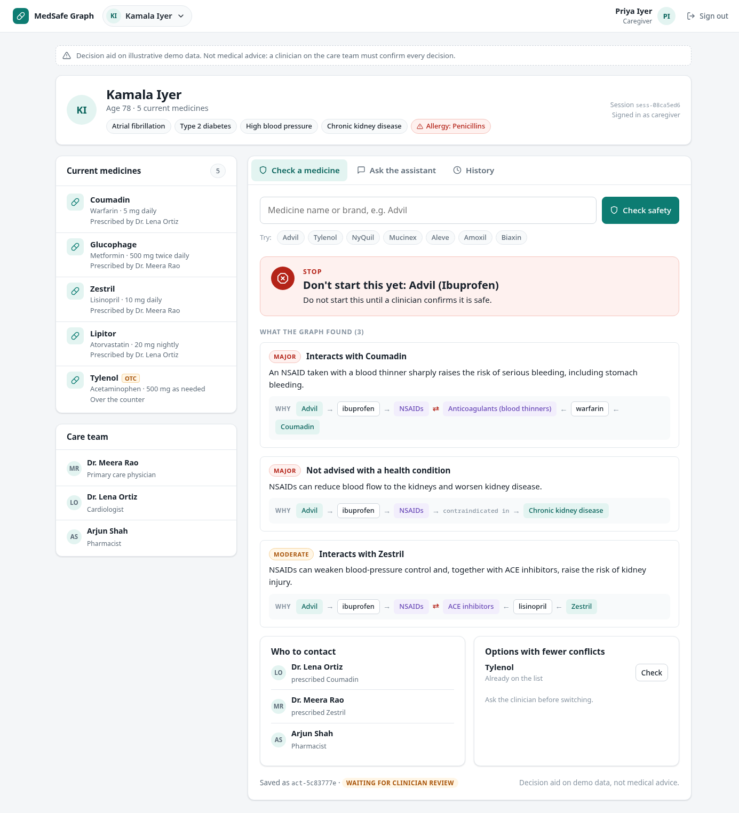
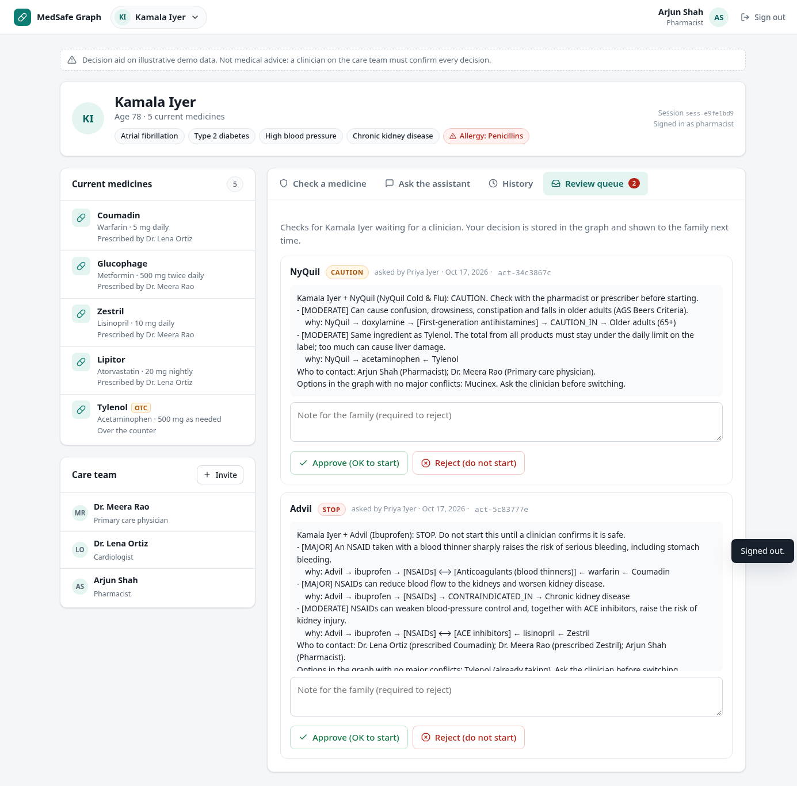
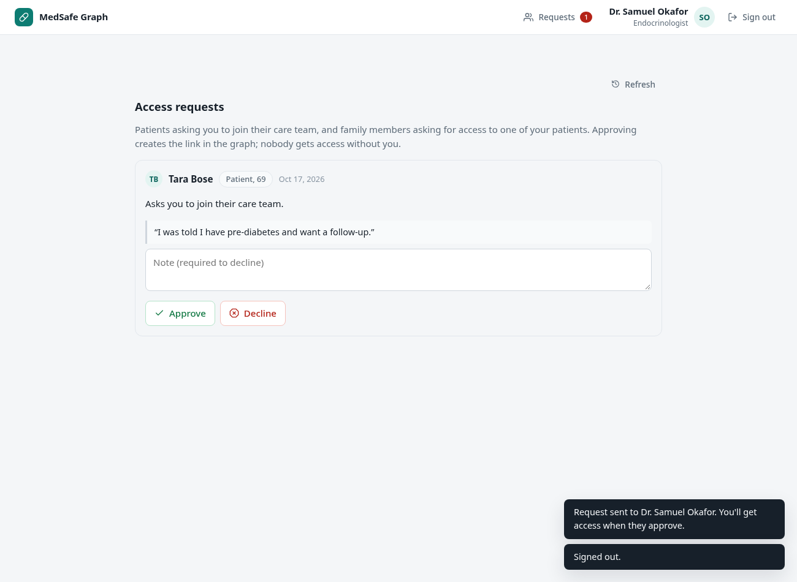
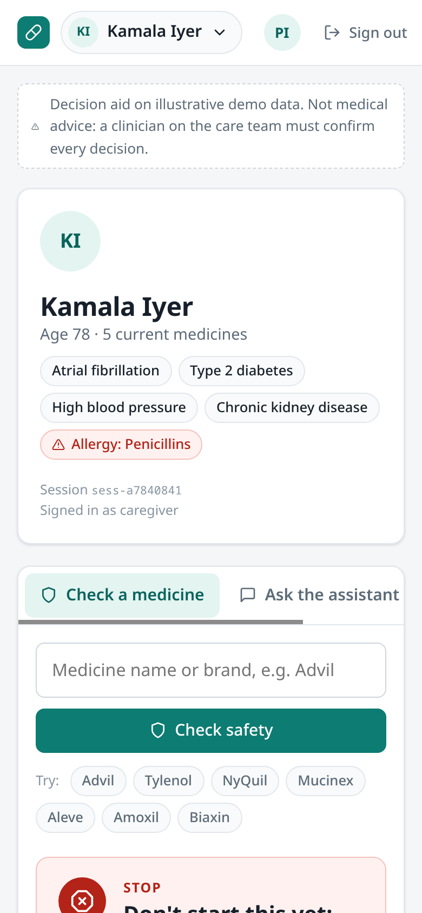

# Medication Safety Graph: Graph Hacks (FalkorDB)

**[Live app](https://graph-hacks-medicine-safety-app-amber.vercel.app/)** · **[Demo video](https://youtu.be/wKzizR8iS9Y)** · **[Blog post](https://medium.com/@agni5kartik/can-mum-take-an-advil-building-a-medication-safety-checker-on-a-knowledge-graph-fca111808bb2)**

Demo logins: `priya`, `shah`, `okafor`, `rao` (password: `<username>-demo`).

**Tracks entered: 01 (Act on Connected Data) and 02 (Memory & Coordination).**

- **Track 01:** a safety checker agent walks the connected graph (patient → medicines → ingredients → drug classes → interactions, conditions, allergies, age rules → prescribers) and acts on it. It gives a STOP/CAUTION level, explains each warning with its graph path, says who to call, and suggests options with fewer conflicts.
- **Track 02:**
  - A caregiver assistant hands safety questions to the checker agent.
  - Every check and answer is stored in the graph as `:Session`/`:Action` nodes.
  - Accounts, access requests, refresh tokens and access itself all live in the graph. A user (patient, caregiver or clinician) sees only the patients they `CARES_FOR`, and each session is pinned to one patient.
  - Clinician decisions are `REVIEWED` edges, and the graph only allows them from the logged-in clinician on that patient's care team.
  - In the next session, both agents recall earlier decisions. For example: "Dr. Rao decided NOT to start Biaxin: don't raise it again without new information".

A medication safety checker for **patients and family caregivers**, with a web app, an HTTP API and a CLI. Think of Priya, who looks after her mother Kamala (78, five medicines, three doctors). Before Kamala takes something new, even an over-the-counter Advil or NyQuil, Priya asks the assistant. It walks a FalkorDB knowledge graph to find conflicts, shows the **chain of links behind every warning**, names **who to call**, and suggests options that conflict less. Every check stays **pending until a clinician on the patient's care team approves or rejects it**, and that decision is remembered in the graph for next time.

| | |
|---|---|
|  |  |
|  |  |

> **Not medical advice.** The seed data is a small, simplified, illustrative set based on public drug labeling. It is not a clinical reference and must not be used for real decisions. The agents only flag and explain; they never tell anyone to start, stop or change a medicine.

## Why a graph

The dangerous cases are rarely written down in one place:

- **Advil + warfarin** conflict through drug *classes*: `Advil → ibuprofen → [NSAIDs] ⟷ [Anticoagulants] ← warfarin ← Coumadin`
- **NyQuil + Tylenol** conflict because they share an *ingredient*: `NyQuil → acetaminophen ← Tylenol`
- **Amoxicillin** is flagged by an allergy recorded at the *class* level: `Amoxil → amoxicillin → [Penicillins] ← ALLERGIC_TO ← Kamala`
- **Who to call** is a path too: the conflicting medicine → its prescription → the doctor who prescribed it.

Keyword or vector search over drug leaflets finds text that mentions things. A graph follows the links between them, and every hop is explainable.

## Graph model

```
(:Patient {id,name,age})-[:HAS_RX]->(:Rx {dose,since,active,otc})-[:OF]->(:Drug {id,name,brand})
(:Clinician {name,role})-[:PRESCRIBED]->(:Rx)          (:Clinician|:Caregiver {username,pass_hash})-[:CARES_FOR]->(:Patient)
(:Drug)-[:CONTAINS]->(:Ingredient)-[:IN_CLASS]->(:DrugClass {dup_check})
(:Ingredient|:DrugClass)-[:INTERACTS_WITH {severity,effect,source}]-(:Ingredient|:DrugClass)
(:Ingredient|:DrugClass)-[:CONTRAINDICATED_IN {severity,reason}]->(:Condition)<-[:HAS_CONDITION]-(:Patient)
(:Ingredient|:DrugClass)-[:CAUTION_IN {severity,reason}]->(:AgeGroup {min_age})
(:Patient)-[:ALLERGIC_TO {reaction}]->(:Ingredient|:DrugClass)
(:Drug)-[:TREATS]->(:Indication)                         # drives "options with fewer conflicts"
session: (:Session)-[:BY]->(:Caregiver|:Clinician), (:Session)-[:ABOUT]->(:Patient)
memory: (:Action {kind,level,status,summary})-[:IN_SESSION]->(:Session)
        (:Action)-[:FOR_PATIENT]->(:Patient), (:Action)-[:ON_DRUG]->(:Drug)
        (:Clinician)-[:REVIEWED {decision,note,ts}]->(:Action)
```

The key trick is `(ingredient)-[:IN_CLASS*0..1]->(x)`: `x` is either the ingredient itself or its class. One query therefore catches both ingredient-level and class-level rules (see `src/tools.js`).

Other Cypher it relies on:
- undirected `-[:INTERACTS_WITH]-`, so each interaction is stored only once
- shared-ingredient patterns `(cur)-[:CONTAINS]->(i)<-[:CONTAINS]-(new)` to catch duplicates
- `WHERE p.age >= g.min_age` for age rules
- `collect(DISTINCT …)` for patient profiles
- conditional linking with `FOREACH … CASE` for memory
- graph-enforced access: `MATCH (u {id:$user})-[:CARES_FOR]->(p {id:$patient}) CREATE (s:Session)-[:BY]->(u), (s)-[:ABOUT]->(p)` returns nothing (so no session) unless the edge exists
- graph-enforced sign-off with `MATCH (a {status:'pending'})-[:FOR_PATIENT]->(p)<-[:CARES_FOR]-(c:Clinician {id:$me})`

All of these are listed, ready for the Browser, in [`queries.md`](queries.md).

## How it works

```
web app or CLI ──HTTP + Bearer JWT──▶ API + web server (npm start) ──▶ FalkorDB graph "meds"

register / login → access token (15 min) + refresh token (7 days, rotated)
pick a patient you CARES_FOR → POST /sessions → new access token pinned to that patient
caregiver question
  → assistant (LLM tool loop: patient_info | check_medication | recall_history; the patient comes from the session)
       → checker (deterministic): resolve drug
           → 6 graph checks: allergies, interactions, same ingredient, same class, conditions, age
           → level = highest severity (STOP / CAUTION / OK WITH MONITORING / NO CONFLICTS FOUND)
           → contacts (prescribers of the conflicting medicines, pharmacist, primary care)
           → earlier clinician decisions for this patient + drug
           → options for the same indication with no major conflicts
           → optional LLM rewrite in plain language (facts from the report only)
           → recorded as Action {status:'pending'}
  → logged-in clinician /approve or /reject (graph rule: on the patient's care team, this session's patient, once)
  → next session, the decision is recalled
```

The LLM never decides the level. It routes questions and rephrases. The safety logic is plain code that is unit-tested.

## Accounts, tokens and patient scope

**Identity is the person, not the patient.** You log in as a caregiver or clinician. Patient IDs are printed on cards and letters and are often guessable, so they are not secrets. One caregiver can also look after several people.

**Registration** creates one of two account types, each starting with access to nobody else:

- **Patient:** manages their own record. It's a `:Patient` node with a login and a `CARES_FOR` edge to itself. Age is required, because the age rules need it.
- **Caregiver:** a family member or friend. Starts with **no patients**.

Clinician accounts can't be self-registered, because a clinician can approve medicines; an administrator creates them.

**Access is requested and approved, never self-granted** (`(:AccessRequest)-[:FROM]->(user)`, `-[:TO]->(:Clinician)`):

1. **Picking a doctor:** the user picks one from the **doctor directory**, which shows each doctor's role and how many patients they have.
2. **A patient asks a doctor to join their care team.** On approval, the graph gets `(doctor)-[:CARES_FOR]->(patient)`. One doctor can care for any number of patients.
3. **A caregiver asks a doctor for access to someone they look after, giving that person's name.** They can't search for patients. The doctor sees the request and chooses the matching person **from the doctor's own patients**. On approval, the graph gets `(caregiver)-[:CARES_FOR]->(patient)`.
4. **The doctor's inbox:** doctors see pending requests and approve or decline them; declining needs a reason, which the requester sees. Duplicate pending requests are refused, and each request can be decided only once.

**The record is editable, and every change records who made it.**

- Patients and caregivers can add over-the-counter medicines and allergies.
- Doctors add prescriptions (recorded as `PRESCRIBED` by them) and diagnoses, and can stop any medicine.
- In the web app, a new medicine is **checked before it's added**. The safety verdict is shown first, and adding it is a separate click.

**Tokens** (HS256 JWT, signed with `node:crypto`; no extra dependencies):

| | lifetime | carries | stored |
|---|---|---|---|
| access token | 15 min | `sub`, name, kind/role, and after you pick a patient: `sid` (session) + `pid` (patient) | client only |
| refresh token | 7 days | `sub`, `fam` (login family), `jti` | client + `(:RefreshToken {jti, family, revoked})-[:ISSUED_TO]->(user)` in the graph |

- Every request re-checks the account and the `CARES_FOR` edge. Removing someone from a care team cuts them off immediately, even if their access token is still valid.
- **Refresh rotates.** Each refresh token works once and is replaced. If a used refresh token is presented again, it was probably copied, so the server revokes the whole login (family) and both parties must log in again.
- **Logout** revokes the login's refresh tokens on the server.
- **Only HS256 is accepted** (no `alg:none`). Signatures are compared in constant time. Access and refresh tokens use different secrets and a `typ` claim, so one can't be used as the other.
- **Login throttling:** 5 failed logins per username and address lock that pair for 15 minutes. A wrong password and an unknown username give the same answer.
- **Passwords:** salted scrypt hashes, 10+ characters, and they can't contain the username.
- **The CLI** stores tokens in `~/.config/med-safety-graph/credentials.json` (mode 600). It refreshes automatically when the access token expires, so you stay logged in for up to 7 days of inactivity.

**Scope inside a session.** Everything you ask is about the session's patient. The LLM gets only fixed, patient-scoped tools, and `dispatch()` takes the patient from the session, ignoring any patient the model puts in tool arguments. Free-form LLM-written Cypher was removed because it can't be reliably limited to one patient. `/switch` opens a new session for another patient.

**Approvals** act as the logged-in clinician, only for the current session's patient, and only once per check. Caregivers can't approve.

Demo logins (password is `<username>-demo`, e.g. `priya-demo`). All of them are listed on the sign-in page.

| username | who | can see |
|---|---|---|
| `priya` | Priya Iyer, caregiver (daughter) | Kamala, Ravi |
| `sam` | Sam Iyer, caregiver (son) | Ravi |
| `rao` | Dr. Meera Rao, primary care | Kamala, Ravi |
| `ortiz` | Dr. Lena Ortiz, cardiologist | Kamala |
| `shah` | Arjun Shah, pharmacist | Kamala, Ravi |
| `menon` | Dr. Kavita Menon, geriatrician | nobody yet: request her |
| `okafor` | Dr. Samuel Okafor, endocrinologist | nobody yet: request him |

Plus 22 more specialists in the directory, all starting with no patients and all signing in as `<username>` / `<username>-demo`:

| username | specialty | username | specialty |
|---|---|---|---|
| `desai` | Nephrologist | `idrissi` | Orthopedic surgeon |
| `feld` | Neurologist | `asante` | Urologist |
| `rahman` | Psychiatrist | `mlwong` | Ophthalmologist |
| `herrera` | Pulmonologist | `nolan` | ENT specialist |
| `tanaka` | Gastroenterologist | `ribeiro` | Hematologist |
| `mwangi` | Rheumatologist | `karimi` | Allergist and immunologist |
| `brandt` | Dermatologist | `carter` | Family medicine physician |
| `haddad` | Oncologist | `sethi` | Internal medicine physician |
| `pillai` | Infectious disease specialist | `martin` | Emergency medicine physician |
| `lindqvist` | Obstetrician-gynecologist | `novak` | Pain medicine specialist |
| `cohen` | Pediatrician | `petrova` | Clinical pharmacist |

The web directory has a search box (name or specialty).

API (JSON):

| | |
|---|---|
| public | `POST /auth/register` `POST /auth/login` `POST /auth/refresh` `POST /auth/logout` |
| logged in | `GET /me` `POST /sessions` `GET /catalog` `GET /clinicians` `POST /requests` `GET /requests` |
| with a patient session | `GET /patient` `POST /ask` `POST /check` `GET /history?drug=` `POST /patient/medications` `POST /patient/medications/stop` `POST /patient/allergies` `POST /patient/conditions` (clinician) |
| clinicians | `POST /requests/decide` `GET /pending` `POST /reviews` |

## Run it

Requires Node.js 20+ and FalkorDB (`docker run -p 6381:6379 -p 3000:3000 -it --rm falkordb/falkordb:latest`; Browser UI at http://localhost:3000). Tested live against FalkorDB module v4.22.1 (`falkordb/falkordb:latest`), Node 24 and the `falkordb` npm client v6; sample output is in [`docs/demo-output.txt`](docs/demo-output.txt). The Anthropic adapter was checked live (claude-haiku-5-5). The OpenAI adapter is only unit-tested. With no key, `offline` mode (a keyword router) still exercises the tools, handoff, memory and sign-off.

```
cp .env.example .env      # set JWT_ACCESS_SECRET / JWT_REFRESH_SECRET (openssl rand -hex 32); optional LLM key
npm install
npm run seed              # resets graph "meds" and loads seed.cypher
npm run demo              # scripted story (starts its own API): requests + approvals, JWT, scoping, review, token reuse, memory
npm start                 # web app + API on http://127.0.0.1:8787  (open it in a browser)
npm run cli               # optional: the terminal client (needs npm start running)
npm run check             # lint + unit tests + live integration and API tests (throwaway graphs)
```

Try it in the browser (`npm start`, then open http://127.0.0.1:8787):

1. **Caregiver:** sign in as `priya` and pick Kamala. Check **Advil** (STOP: blood thinner and kidney disease) and **NyQuil** (CAUTION: doubled acetaminophen and the age rule). Ask the assistant "What did we decide about Biaxin?".
2. **Pharmacist:** sign in as `shah`, pick Kamala and open **Review queue**. Reject NyQuil with a note, then sign back in as `priya` and look at **History**.
3. **New patient:** on **Create account**, choose "The patient", then request **Dr. Okafor**. Sign in as `okafor`, open **Requests** and approve. Back as the patient, use **Add** on Advil to see the check-before-add flow.
4. **New caregiver:** register as "Looking after someone" and request **Dr. Rao** for "Ravi Iyer". As `rao`, approve and link Ravi.

The CLI (`npm run cli`) has the same features: `/login`, `/register`, `/doctors`, `/request <n>`, `/requests`, `/accept <id> [patient n]`, `/decline <id> -- reason`, `/check <drug>`, `/add <drug> -- dose`, `/history`, `/pending`, `/approve`, `/reject`.

## Roadmap to real-world use

1. **Real drug data.** Use RxNorm for drug, ingredient and brand identity, and openFDA/DailyMed for label text. NLM retired its free interaction API in 2024, so interactions need DDInter (non-commercial) or a licensed source (e.g. DrugBank, First Databank). Load it with `MERGE` and record provenance (`source`, `version`, `retrieved_at`) on every edge.
2. **Name matching.** Use RxNorm normalisation plus fuzzy or vector matching so "tylenol extra strength 500" resolves to the right product.
3. **Dose awareness.** Add daily dose totals, for example summing acetaminophen across all products against the daily limit.
4. **Check the whole list.** Review the current medicines against each other, not only a new one (e.g. Ravi's Aleve + aspirin).
5. **Privacy and access.** Follow HIPAA/GDPR: encrypt the data and require the patient's consent before a caregiver gets a `CARES_FOR` edge. Add MFA, HTTPS, a shared store (e.g. Redis) for login throttling across servers and secret rotation. The audit log is already modelled as Actions. Use a self-hosted LLM if needed (`OPENAI_BASE_URL`).
6. **Clinical validation.** Have a pharmacist review the rules and the wording before anyone relies on it.
